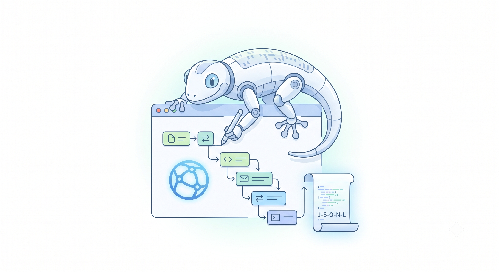

# Steno — Manual Test Session Recorder

[](https://github.com/amasotti/steno/actions/workflows/ci.yml)
[](./LICENSE)

> A headful Chromium session recorder and inspector. It turns a manual test flow into a clean,
> signal-only timeline that both a human and an LLM agent can read. **Records everything that
> matters, judges nothing.**



## What is Steno?

When you test a web app by hand clicking through a flow that spans several services, redirects
between origins, and hits a dozen APIs — there is no good record of *what actually happened*. The
DevTools network tab is ephemeral, scoped to one page, and drowned in static assets (JS bundles,
CSS, fonts, images, analytics beacons). The moment you close the tab, the evidence is gone.

Steno fills exactly that gap. You drive a real browser by hand; Steno watches over the Chrome
DevTools Protocol (CDP) and writes a durable, ordered timeline of the **meaningful** calls and
navigations — origin, path, method, status, full request/response payloads, and basic timing. The
result is a faithful, low-noise audit of the front-of-house journey:

- **Skimmable by a human** — a chronological list and a Mermaid sequence diagram of the journey.
- **Ingestable by an agent** — a compact `timeline.jsonl` that Claude Code, Codex, or any LLM can
  read to write a report, reconstruct the flow, or localise a failure.

It is a stenographer, not an investigator: it captures the session in full and makes no judgements.

## Why you'd want it

- **Audit a manual test.** Keep an ordered record of which systems were touched, in what order, and
  what they returned — long after the tab is closed.
- **Localise failures fast.** A non-2xx response is pinned to a specific origin and call, with both
  payloads attached, without opening any other tool.
- **Hand a clean trace to an agent.** The timeline is the most token-efficient form of "here is what
  happened in the browser" you can give an LLM.
- **Re-fire a captured request.** Turn any recorded call into a copy-paste `curl` command.

## Features

- **Headful capture over CDP** — launches a real Chromium-family browser you click through yourself.
  Works with Chrome, Edge, Brave, and any other Chromium binary.
- **Signal-only by design** — a config-driven filter cuts the noise in order: resource-type
  allowlist → host allowlist → preflight drop → path denylist. Tens of meaningful calls survive, not
  thousands of asset requests.
- **Full-fidelity payloads** — request and response bodies are written verbatim to side-files and
  referenced from the timeline. Nothing is truncated, masked, or redacted (it records test data, so
  full fidelity is the point).
- **Journey reconstruction** — top-frame navigations and redirects are captured as `navigation`
  events, so the timeline shows the route, not just the API calls.
- **Inspect from the CLI** — list calls, filter by origin or status (`4xx,5xx`), and dump one call's
  headers and payloads by sequence id.
- **Derived artifacts** — generate a Mermaid sequence diagram of the cross-system journey from the
  canonical timeline, re-runnable without re-recording.
- **Replay as curl** — reproduce any recorded request from the terminal.
- **Single static binary** — download one file and run it. No runtime to install.

## What Steno deliberately does *not* do

- It does **not** drive the browser or replay sessions — the human drives, Steno only observes. If
  you need automation, use Playwright / Puppeteer / Selenium / chrome mcp servers for that.
- It does **not** capture literal clicks or keystrokes (CDP cannot observe real input, and Steno
  injects no scripts). The journey is reconstructed from navigation and network events.
- It is **not** a DOM/pixel session-replay tool (it is not rrweb) and **not** a full network profiler
  (no HAR-level timing waterfalls).
- It contains **no LLM** and makes no analysis. That happens downstream, in an agent that reads the
  artifacts.

See [`docs/spec.md`](docs/spec.md) for the full behavioral contract and the non-goals in detail.

## Install

**Download a release binary** (no Go toolchain needed) from the
[Releases page](https://github.com/amasotti/steno/releases). Builds are published for `linux/amd64`,
`darwin/arm64`, and `windows/amd64`, each with a `SHA256SUMS` checksum file. Unpack it, put `steno`
on your `PATH`, and run it.

**Or install with Go** (any platform Go supports):

```sh
go install github.com/amasotti/steno/cmd/steno@latest
```

## Quick start

```sh
# 1. Record. A headful browser opens; click through your flow, then Ctrl-C to stop.
steno record --out ./runs/demo --config config.toml

# 2. Inspect. List the meaningful calls and navigations.
steno inspect ./runs/demo

# 3. Drill into one call — headers and full payloads — by its sequence id.
steno inspect ./runs/demo --seq 42

# 4. Find what failed.
steno inspect ./runs/demo --status 4xx,5xx

# 5. Render a Mermaid sequence diagram of the journey.
steno render ./runs/demo            # writes ./runs/demo/flow.mmd

# 6. Re-fire a captured request as curl.
steno replay ./runs/demo 42
```

A run directory ends up looking like:

```
runs/demo/
├── timeline.jsonl          # the canonical, ordered record (one event per line)
├── flow.mmd                # Mermaid sequence diagram (after `steno render`)
└── payloads/               # full request/response bodies + headers, referenced from the timeline
    ├── 0042-req.txt
    ├── 0042-res.txt
    ├── 0042-req-headers.json
    └── 0042-res-headers.json
```

## Commands

| Command | Purpose |
| --- | --- |
| `steno record`  | Launch a browser, capture the session, write the timeline and payloads. |
| `steno inspect` | Read a recording: list events, filter, or show one event in full. |
| `steno render`  | (Re)generate `flow.mmd` from an existing timeline. Pure and offline. |
| `steno replay`  | Print a `curl` command that reproduces one recorded call. |
| `steno version` | Print the build version. |

### `steno record`

| Flag | Required | Description |
| --- | --- | --- |
| `--out <dir>`     | yes | Output directory for `timeline.jsonl` and `payloads/`. |
| `--url <url>`     | no  | URL to open at start. Overrides `start_url` from the config. |
| `--config <file>` | no  | Path to a TOML config (see below). Without it, built-in defaults apply. |

Recording runs until you interrupt it (`Ctrl-C`); a compact session summary is printed on shutdown.

### `steno inspect <run>`

Accepts a run directory or a path to a `timeline.jsonl`.

| Flag | Description |
| --- | --- |
| `--origin <substr>`  | Case-insensitive substring filter on the call origin. |
| `--status <list>`    | Comma-separated status codes or classes, e.g. `404`, `4xx,5xx`. |
| `--seq <id>`         | Show full detail (headers + both payloads) for a single event. |

### `steno render <run>`

Generates `flow.mmd` (a Mermaid sequence diagram) in the run directory. Recording and rendering are
separate so you can iterate on the diagram without re-recording.

### `steno replay <run> <seq>`

Prints a copy-paste-ready `curl` for the call at `<seq>`, built from its captured headers and body.
If the recording was made without `include_headers`, it still prints the command but warns on stderr
that `Cookie` / `Authorization` are missing.

## Configuration

Everything is optional: with no `--config`, `steno record` reproduces sensible built-in defaults. A
single TOML file declares the launch target, the filters, and the payload policy. Copy the example
and adapt it.

See [`config.example.toml`](config.example.toml) for every key, with comments. The `[correlation]`,
`[[extract]]`, and `[[supplemental]]` sections are parsed but reserved for future work — they have
no effect today.

## Documentation

- [`docs/spec.md`](docs/spec.md) — the behavioral contract: what Steno does, its non-goals, the event
  model, the CLI, and the resolved design decisions.
- [`docs/architecture.md`](docs/architecture.md) — internals: package boundaries, the `timeline.jsonl`
  schema, the protocol-agnostic recorder seam, and the design choices behind them.
- [`AGENTS.md`](AGENTS.md) — guidance for humans and AI agents contributing to the repository.

## Building from source

```sh
just build      # build ./bin/steno
just test       # run the unit tests
just lint       # golangci-lint
just ci-local   # fmt + lint + test + build
```

## License

[MIT](./LICENSE).
