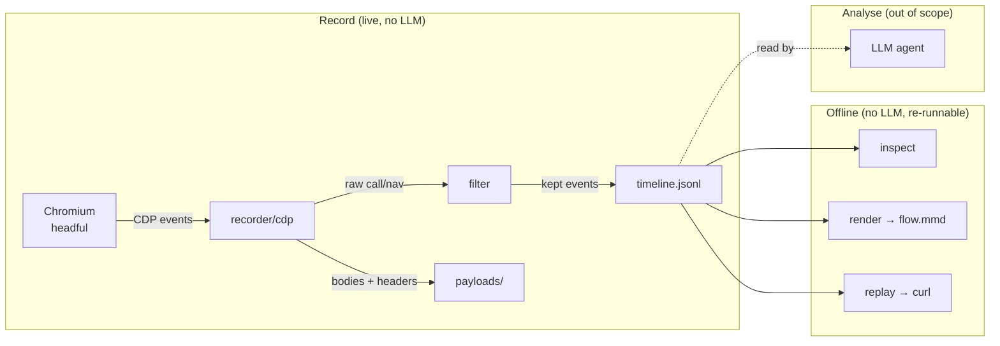

# Steno — Architecture

How Steno is put together and why. This document covers the package boundaries, the contracts between
them, the data model, and the design choices that earned their place. For *what* Steno does as a
product, see [`spec.md`](./spec.md).

## 1. Shape of the system

Steno is a single static Go binary with one job split across two phases that never overlap in code:



The **record** path is the only thing that touches a browser. Everything downstream reads the
artifacts on disk and can be re-run forever without re-recording. There is no LLM anywhere in the
binary.

## 2. Package map

One clear responsibility per package. Source under `internal/`, entrypoint under `cmd/`.

| Package | Responsibility |
| --- | --- |
| `cmd/steno` | Process startup only: signal context (SIGINT/SIGTERM), delegate to `cli.Run`, set exit code. |
| `internal/cli` | Command parsing and dispatch for `record` / `inspect` / `render` / `replay` / `version`. Holds the build `Version` var. |
| `internal/config` | The TOML configuration model, `Default()`, and `Load()`. Forward-compatible (unknown keys ignored). |
| `internal/recorder` | The protocol-agnostic `Recorder` seam. |
| `internal/recorder/cdp` | The CDP implementation of `Recorder` — the **only** package that imports `chromedp`/`cdproto`. |
| `internal/filter` | CDP-free signal filtering, applied in a fixed order. |
| `internal/timeline` | Normalized `Event` types and JSONL read/write. The contract shared by every other layer. |
| `internal/payload` | Writes request/response bodies and headers to the `payloads/` side-file store. |
| `internal/inspect` | Reads a recording for CLI inspection: list, filter, per-seq detail, artifact reads. |
| `internal/render` | Derives `flow.mmd` from the timeline. |
| `internal/replay` | Builds a `curl` command from one event plus its captured headers and body. |
| `internal/summary` | Computes and prints the end-of-run session summary. |

The dependency arrows point inward to `timeline`: `recorder`, `filter`, `inspect`, `render`, `replay`,
and `summary` all speak in `timeline.Event`, and none of them imports a CDP type.

## 3. The central seam — `Recorder`

The whole capture core sits behind one interface:

```go
type Recorder interface {
    Record(ctx context.Context) (<-chan timeline.Event, <-chan error)
}
```

`Record` streams **normalized** `timeline.Event` values on one channel and errors on another, until
the context is cancelled (the user hits `Ctrl-C`). The caller in `internal/cli` drains the event
channel into `timeline.WriteJSONL`, hands kept calls' bodies to the payload store, and feeds the
summary — all without knowing CDP exists.

**The hard rule: no CDP type leaks past `internal/recorder/cdp`.** Resource types arrive as plain
strings, navigations and calls arrive as `timeline.Event`. This keeps `filter`, `inspect`, `render`,
and `replay` trivially unit-testable without a browser, and keeps capture-protocol concerns from
bleeding into the rest of the codebase.

### Inside the CDP recorder

`internal/recorder/cdp` launches a headful browser with `chromedp.NewExecAllocator` (launch only — see
[§6](#6-design-decisions)), enables the `Network` and `Page` domains on the single tab, and folds the
CDP event sequence into normalized events:

- `RequestWillBeSent` → `ResponseReceived` → `LoadingFinished` is collapsed into one `call` event;
  `*ExtraInfo` events supply the raw headers (including cookies).
- top-frame `Page.frameNavigated` becomes a `navigation` event; sub-frames and scheme-less URLs
  (`about:blank`) are dropped.
- a worker goroutine writes request/response bodies and headers to the payload store off the CDP
  listener path, so the listener never blocks.

Filtering is applied here, before an event is emitted, so downstream consumers only ever see kept
events.

## 4. The timeline contract

`timeline.jsonl` is the canonical artifact and the contract every other output depends on: one JSON
object per line, ordered by `seq`. The `Event` struct:

| Field | JSON | Notes |
| --- | --- | --- |
| `Seq` | `seq` | Monotonic sequence number, shared across `call` and `navigation`; preserves real order. |
| `Time` | `ts` | Wall-clock timestamp (RFC 3339). |
| `Kind` | `kind` | `navigation` or `call`. |
| `Origin` | `origin` | Scheme + host, e.g. `https://account.int.example`. |
| `Method` | `method` | HTTP method (`call` only). |
| `Path` | `path` | Path including query string (`call` only). |
| `Status` | `status` | HTTP status code (`call` only). |
| `DurationMS` | `duration_ms` | Derived from request/response timing. |
| `SizeBytes` | `size_bytes` | Transferred response size. |
| `RequestRef` / `ResponseRef` | `request_ref` / `response_ref` | Relative paths to body side-files. |
| `RequestHeadersRef` / `ResponseHeadersRef` | `request_headers_ref` / `response_headers_ref` | Relative paths to header side-files; present only when `include_headers` is on. |

Contract guarantees that downstream code and agents may rely on:

- **Append-only, ordered.** Lines are written in `seq` order and never rewritten.
- **Bodies live beside the timeline, never inside it.** Payloads are referenced by relative path, so
  the JSONL stays compact and bodies are never truncated.
- **Empty fields are omitted** (`omitempty`), so a `navigation` line carries only what it has.
- **The schema is additive.** New optional fields may appear; existing fields keep their meaning, so
  recordings and agents on disk stay readable.

## 5. The payload store

`internal/payload` owns the `payloads/` directory layout, keyed by sequence id:

- `{seq:04d}-req.txt` / `{seq:04d}-res.txt` — request / response bodies, verbatim.
- `{seq:04d}-req-headers.json` / `{seq:04d}-res-headers.json` — raw header maps, when `include_headers`.

Document bodies are skipped unless `include_documents` is set. Unsupported or missing bodies are
skipped without failing the recording — a partial payload must never abort a live session. `inspect`
and `replay` read these files back through `inspect.ReadArtifact`, resolving the relative ref against
the run directory.

## 6. Design decisions

- **Go.** A mature CDP client ecosystem (`chromedp`/`cdproto`); a concurrency model where merging
  browser event streams into one ordered timeline is idiomatic (channels + a draining goroutine); and
  single static binaries with trivial cross-compilation. The headline distribution requirement —
  colleagues just download and run — falls out of Go for free.
- **CDP, Chromium family only.** One protocol covers Chrome, Edge, Brave, Opera. Non-Chromium engines
  are deliberately out of scope.
- **Launch a managed browser.** Steno launches a headful instance with a dedicated profile the human
  drives. Capture is scoped to that tab.
- **No redaction, ever.** Steno records test sessions on test data; credentials, tokens, and cookies
  are evidence, not liabilities. Masking is a permanent non-goal, not an unbuilt feature. Recordings
  are local artifacts the user owns.
- **Record and render are separate verbs.** Derived artifacts come from the canonical timeline, so the
  diagram (and any future renderer) can be iterated without re-recording — and an agent can consume
  `timeline.jsonl` directly.
- **Filter is CDP-free and order-sensitive.** Keeping the filter a pure function over
  `(resourceType, Event)` makes the largest noise-reduction logic fully testable and keeps the recorder
  free of policy.

## 7. Testing and verification boundary

`internal/filter`, `timeline`, `inspect`, `render`, and `replay` are pure and unit-tested without a
browser — that is the payoff of the `Recorder` seam. The CDP recorder is the one component that needs a
real browser to exercise end to end, and launching a browser is the boundary an automated agent must
not cross (see [`AGENTS.md`](../AGENTS.md)). Checks run through `just`: `just fmt`, `just lint`,
`just test`, `just build`, or `just ci-local` for all of them.

## 8. Distribution

A single GitHub Actions pipeline on push to `main` gates on CI (lint, test, build, govulncheck),
computes the next semver from conventional-commit history, tags, cross-compiles `linux/amd64`,
`darwin/arm64`, and `windows/amd64` with the version injected via
`-ldflags -X internal/cli.Version`, generates a `git-cliff` changelog, and publishes a GitHub Release
with the archives and a `SHA256SUMS` file. `go install github.com/amasotti/steno/cmd/steno@latest`
covers any other platform.
